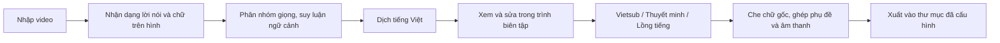

# DubFlow — Luồng logic kỹ thuật hiện tại

Cập nhật: 31/10/2026, múi giờ Asia/Saigon.

Tài liệu mô tả phần đã có trong mã nguồn và cấu hình hiện tại. Các kết quả kiểm tra cấu trúc, ASR hoặc xuất file không phải chứng nhận bản dịch, cảm xúc hay chất lượng video đã đạt.

## 1. Tổng quan

DubFlow chạy theo luồng **tự động tạo bản tiếng Việt → người dùng xem và sửa trực tiếp trong trình biên tập → xuất video**. Không bắt buộc đi qua màn hình duyệt riêng.



## 2. Kiến trúc và lưu trữ

| Thành phần | Công nghệ / vai trò |
|---|---|
| Giao diện | React + TypeScript, build bằng Vite |
| Backend | FastAPI / Python |
| Dữ liệu công việc | SQLite |
| Thực thi tác vụ | Worker cục bộ xử lý tuần tự |
| Xử lý media | FFmpeg / FFprobe |
| Dịch hiện tại | Ollama local tại cổng 11439 |

Video nhập vào được lưu trong dữ liệu dự án trên ổ D. Mỗi công việc có thư mục chứa nguồn, câu thoại, vùng chữ, kết quả các bước, cache và log.

Model, cache, môi trường thử, file tạm và kết quả mới được lưu trên ổ D. Bản cài `D:\OmniVoice` được giữ nguyên; các môi trường thử chỉ dùng lại thư viện hoặc cache có sẵn theo cấu hình.

Worker chạy các bước model nặng lần lượt để hạn chế tranh chấp GPU. Mỗi bước nặng được gọi qua tiến trình Python riêng, tránh nạp toàn bộ model vào tiến trình web.

## 3. Nhập video và tạo công việc

Khi người dùng tải video lên, backend:

1. Lưu video vào thư mục công việc trên ổ D.
2. Dùng FFprobe đọc thời lượng và kích thước khung hình.
3. Tạo ảnh xem trước và phần video mặc định.
4. Lưu thông tin tên video, chế độ, bộ sưu tập và các thiết lập liên quan.
5. Nếu bật tự dịch và bộ dịch đã được cấu hình, đưa công việc vào hàng đợi phân tích.

Cấu hình hiện tại đã bật tự dịch khi nhập video. Công việc phân tích/dịch và công việc xuất video là các tác vụ riêng; phân tích xong không đồng nghĩa đã tự xuất file cuối.

## 4. Nhận dạng lời nói và chữ trên hình

### 4.1. Nhận dạng lời nói — ASR

Hệ thống dùng **Whisper large-v3-turbo** để nhận dạng tiếng Trung.

Đầu ra gồm:

- Lời gốc tiếng Trung.
- Timestamp ở mức đoạn.
- Các cue có ID, thời gian bắt đầu/kết thúc và nhãn giọng.

Timestamp hiện tại không phải căn chỉnh từng từ bằng WhisperX và không phải dữ liệu lip-sync. ASR vẫn có thể nhận nhầm lời hát, tiếng nền hoặc lời thoại.

### 4.2. Nhận dạng chữ — OCR

Hệ thống dùng **RapidOCR trên CPU**, cấu hình quét 4 khung hình mỗi giây.

Đầu ra gồm:

- Chữ đọc được trên hình.
- Vị trí và kích thước vùng chữ.
- Thời gian xuất hiện.
- Mặt nạ chữ khi có thể tạo được.

Các vùng được phân loại thành:

| Loại | Cách xử lý dự kiến |
|---|---|
| Phụ đề nguồn | Che chữ gốc và đặt phụ đề Việt tại vị trí tương ứng |
| Chữ cố định / logo | Che vùng chữ nhận diện được |
| Thông tin xuất hiện thoáng qua | Dịch nội dung, che chữ nguồn và hiển thị bản Việt |

Phân loại này dựa trên kết quả OCR và đặc điểm vị trí/thời gian, chưa bảo đảm luôn đúng. Chữ xuất hiện quá ngắn có thể bị bỏ sót giữa hai khung lấy mẫu.

### 4.3. Đối chiếu nguồn

Kết quả ASR và OCR được giữ riêng để đối chiếu. Hệ thống có thể đánh dấu mâu thuẫn giữa chúng, không mặc định ASR hoặc OCR luôn đúng và không tự dùng một nhánh làm chứng nhận cho nhánh còn lại.

## 5. Tách nền và phân nhóm giọng

### 5.1. Tách nền

Ở chế độ **lồng tiếng**, Demucs tách phần giọng và phần nền để:

- Lấy mẫu giọng từ nguồn đã giảm nhạc nền.
- Trộn phần nền trở lại với giọng Việt.

Stem nền có thể còn tiếng gốc hoặc mất một phần hiệu ứng âm thanh. Có file stem không chứng minh việc tách đã hoàn hảo.

### 5.2. Phân nhóm giọng

ECAPA tạo vector giọng từ những đoạn ASR đủ điều kiện, sau đó tạo các ứng viên nhóm giọng.

Giới hạn hiện tại:

- Đây chưa phải diarization liên tục có xử lý chồng thoại đầy đủ.
- Đoạn ngắn hoặc nhiều nhiễu có thể không đủ tin cậy.
- Nếu kết quả thiếu tin cậy, hệ thống giữ nhãn chưa rõ thay vì tự gán cho xong.
- Nhãn nhóm giọng không đồng nghĩa với tên nhân vật, vai trò hoặc người nghe.

Chuỗi thông tin cần phân biệt là:

```text
Lượt nói → nhãn giọng → nhân vật nói → người nghe
```

Hệ thống hiện chưa tự xác định chắc chắn toàn bộ chuỗi này.

## 6. Suy luận ngữ cảnh và dịch tiếng Việt

### 6.1. Cấu hình hiện tại

| Thiết lập | Giá trị |
|---|---|
| Provider | Ollama local |
| Model | `qwen3:4b-instruct-2507-q4_K_M` |
| Context | 4096 token |
| Tự dịch khi nhập | Bật |

Luồng đang dùng model local, không gọi API trả phí. Mã nguồn có nhánh provider khác nhưng chúng không đồng nghĩa đang được sử dụng trong cấu hình này.

### 6.2. Suy luận ngữ cảnh

Model đọc dữ liệu lời thoại để tạo bản tóm tắt ngữ cảnh và gợi ý xưng hô. Bản suy luận tự động được coi là ứng viên có thể sai.

Bước này hiện chủ yếu dựa vào văn bản; chưa xem hình để nhận biết chắc chắn nhân vật nào đang nói với ai. Với video dài, ngữ cảnh tổng quan cũng bị giới hạn bởi việc lấy mẫu và ngân sách context.

### 6.3. Dịch theo cửa sổ lời thoại

Khi dịch một câu, hệ thống cung cấp:

- Câu nguồn cần dịch.
- Tối đa hai lượt trước và hai lượt sau.
- Ngữ cảnh tự động đã suy luận.
- Nhân vật và thông tin gán vai nếu có.
- Quy tắc xưng hô đã xác nhận nếu có.
- Thuật ngữ/ngữ cảnh lưu theo bộ sưu tập nếu có.

Model được yêu cầu dịch tự nhiên, giữ ý và sắc thái, đồng thời trả kết quả theo ID xác định.

### 6.4. Lưu và kiểm tra kết quả

Luồng dịch hiện tại:

- Điền những câu còn trống lời Việt.
- Dịch những vùng thông tin thoáng qua còn thiếu bản dịch.
- Giữ phần người dùng đã nhập hoặc sửa.
- Giữ timestamp khi dịch.
- Kiểm tra ID, cấu trúc đầu ra, câu trống và kết quả bị cắt trước khi lưu.
- Lưu cache, thông tin model, request/response và kết quả theo từng lượt chạy.

Kiểm tra cấu trúc không chứng nhận được nghĩa. Thành ngữ, quan hệ nhân vật, xưng hô và sắc thái vẫn có thể sai dù đầu ra JSON hợp lệ.

## 7. Xem và sửa trong trình biên tập

Sau khi phân tích/dịch, người dùng xem và sửa trực tiếp tại **Lời dịch**. Không bắt buộc qua màn hình duyệt thủ công riêng.

Trình biên tập liên kết:

- Video đang phát.
- Timeline.
- Thời gian và nội dung từng câu.
- Các cảnh báo tự động.
- Vùng chữ nguồn và bản dịch trên hình.

Lời Việt thay đổi được phản ánh trên bản xem trước. Khi chưa có video đã kết xuất hoặc đang có bản chỉnh sửa, trình phát dùng nguồn và lớp phụ đề trực tiếp. Video đã kết xuất không được chồng thêm một lớp phụ đề trực tiếp nữa, để tránh xuất hiện hai bản sub Việt.

Các kiểm tra tự động có thể phát hiện lỗi cấu trúc, thời gian, câu trống và một số dấu hiệu bất thường. Chúng không tự chứng nhận bản dịch đúng nghĩa hoặc diễn xuất đạt.

## 8. Ba chế độ đầu ra

| Chế độ | Xử lý âm thanh | Xử lý hình |
|---|---|---|
| Vietsub | Giữ âm thanh gốc; không sinh giọng | Che chữ nguồn và thêm phụ đề Việt |
| Thuyết minh | Một giọng tham chiếu đã chọn đọc toàn bộ lời Việt; hạ âm thanh gốc rồi trộn giọng đọc | Che chữ nguồn và thêm phụ đề theo cấu hình |
| Lồng tiếng | Lấy mẫu giọng theo nhóm người nói, sinh giọng Việt rồi trộn nền đã tách | Che chữ nguồn và thêm phụ đề theo cấu hình; không lip-sync |

Thuyết minh mặc định giữ nội dung ở dạng lời thoại và dùng một giọng đọc. Hiện chưa có bước mặc định tự chuyển toàn bộ hội thoại thành lời kể. Nếu bổ sung chuyển thành lời kể, đó phải là tùy chọn riêng vì làm thay đổi cách thể hiện nội dung.

### 8.1. Engine giọng đang tích hợp

Web hiện dùng **VoxCPM2** cho phần sinh giọng. Viterbox và các engine đã so sánh trước đây là những bài thử riêng, không phải tất cả đều đang được web gọi.

Ở chế độ lồng tiếng:

- Tìm đoạn tham chiếu riêng cho từng nhãn giọng, ưu tiên đoạn đủ dài và không chồng giọng theo dữ liệu đang có.
- Dùng reference giọng nguồn cùng đoạn mồi tiếng Việt đã cấu hình.
- Nếu không tìm được reference đạt điều kiện kỹ thuật, hệ thống báo lỗi thay vì tự coi mẫu nhiễu là đạt.

Ở chế độ thuyết minh, mọi câu dùng cùng giọng tham chiếu đã chọn trong thư viện.

### 8.2. Sinh ứng viên và sàng lọc

Mỗi câu có thể được sinh nhiều ứng viên với seed khác nhau. Cấu hình hiện tại cho phép tối đa 24 ứng viên mỗi câu, theo từng đợt.

Whisper nhận dạng lại ứng viên để so với nội dung cần đọc. Trong các ứng viên khớp chữ theo bộ lọc, hệ thống chọn ứng viên có thời lượng ngắn hơn.

ASR khớp chữ chỉ là điều kiện sàng lọc. Nó chưa đánh giá được:

- Độ giống giọng gốc.
- Cảm xúc.
- Accent tiếng Việt.
- Độ tự nhiên, rè hoặc méo tiếng.

### 8.3. Đặt audio lên timeline

Audio được giữ tốc độ tự nhiên, không time-stretch để ép vừa từng câu. Hệ thống chỉ trim phần im lặng đầu/cuối theo bộ lọc đang có.

Câu dài có thể bị đặt trễ để tránh chồng giọng. Nếu trễ, tràn lượt nói hoặc vượt thời lượng video quá ngưỡng, hệ thống dừng và báo cần xử lý câu đó; không lặng lẽ cắt mất lời để hoàn tất.

## 9. Che chữ nguồn và ghi phụ đề Việt

### 9.1. Bản xem trước

Trình duyệt hiển thị video nguồn, làm mờ cục bộ theo vùng/mặt nạ OCR và chồng lời Việt lên vị trí tương ứng.

Phụ đề Việt hiện dùng chữ trắng, không nền đen và không viền. Vị trí/cỡ chữ được tính theo khung video thực, tránh lệch vì phần viền trống của trình phát.

### 9.2. Video kết xuất

FFmpeg xử lý vùng chữ nguồn bằng nội suy/xóa cục bộ và làm mềm, giới hạn bởi mặt nạ chữ khi có; nếu thiếu mặt nạ thì dùng vùng OCR đo được. Sau đó phụ đề ASS được ghi trực tiếp vào khung hình.

Vị trí/cỡ chữ được giữ ổn định trong thời gian một cue để tránh nhảy khi OCR hụt vài khung lấy mẫu.

Bản xem trước bằng CSS và bản kết xuất bằng FFmpeg sử dụng hai cơ chế xử lý hình khác nhau. Cần kiểm tra file xuất thực tế; xem trước đúng không tự chứng minh mọi khung hình của file cuối đều đúng.

### 9.3. Giới hạn

- OCR có thể thiếu chữ, nhầm chữ hoặc nhận nhầm vật thể thành chữ.
- Logo có thể bị phân loại thành nhiều vùng nhỏ hoặc nhầm thành chữ thoáng qua.
- Xóa chữ trên nền phức tạp có thể để lại dấu xử lý.
- Chữ thoáng qua chưa dịch có thể làm bước xuất dừng và báo thiếu bản dịch.
- Không có bảo đảm mọi video đều che sạch chữ mà không ảnh hưởng nền.

## 10. Xuất lời Trung

Nút **Xuất lời Trung** tạo file SRT từ trường lời gốc, không lấy bản Việt làm lời nguồn.

Bộ lọc hiện tại loại các ghi chú dạng đánh dấu và những cue đã được đánh dấu là lời bài hát/nhạc/nội dung phụ. Việc lọc phục vụ file xuất, không sửa mất dữ liệu câu trong trình biên tập.

Với video đang kiểm tra, 99 cue được xuất thành 96 câu sau khi bỏ 3 cue đánh dấu lời bài hát.

Giới hạn: lời hát hoặc nội dung phụ chưa được nhận diện/đánh dấu vẫn có thể lọt qua. Bộ lọc này chưa phải hệ thống tự phân biệt chắc chắn mọi câu thoại và mọi lời hát từ âm thanh.

## 11. Kiểm tra và xuất file cuối

Khi người dùng bấm xuất:

1. Kiểm tra dữ liệu câu, thời gian và các điều kiện kỹ thuật.
2. Với chế độ có giọng, sinh/sàng lọc/đặt audio nếu cần.
3. Đo lại vùng chữ cũ chưa đủ dữ liệu khi cần.
4. Che chữ nguồn, thêm phụ đề và trộn audio theo chế độ.
5. Mã hóa video bằng FFmpeg.
6. Giải mã kiểm tra file đầu ra để phát hiện lỗi media.
7. Xuất vào thư mục đã cấu hình, theo tên video và tùy chọn bộ sưu tập/SRT.

Xuất mặc định theo luồng tự động, không yêu cầu xác nhận thủ công toàn bộ nhân vật hoặc ý nghĩa trước. Những lỗi kỹ thuật thực sự vẫn có thể chặn xuất.

Giải mã thành công chỉ xác nhận file có thể đọc, không xác nhận nội dung dịch hay chất lượng nghe/xem.

## 12. Những phần chưa đạt hoặc chưa có

- Chưa bảo đảm ASR lấy đúng toàn bộ lời thoại và loại hết lời hát.
- Chưa nhận diện chắc chắn người nói, nhân vật và người nghe.
- Chưa hiểu đầy đủ ngữ cảnh phim từ hình ảnh và âm thanh.
- Chưa bảo đảm dịch đúng thành ngữ, quan hệ, xưng hô và sắc thái.
- Chưa bảo đảm clone giữ đúng giọng và cảm xúc khi đổi ngôn ngữ.
- Chưa có lip-sync; căn thời gian audio không phải chỉnh khẩu hình.
- OCR và xử lý che chữ vẫn có thể bỏ sót hoặc để lại dấu xử lý.
- Chưa tự học/train lại model từ những lần người dùng sửa lời.
- Chưa kiểm tra tự động được toàn diện chất lượng cảm xúc, độ giống giọng và độ tự nhiên.

## 13. Mã nguồn liên quan

Các đường dẫn dưới đây tương đối với root dự án `D:\DuAnKhoiNghiep\DubFlow`.

| File | Vai trò |
|---|---|
| `backend/dubflow/app.py` | API nhập video, chỉnh sửa, gọi phân tích/dịch/xuất và phục vụ media |
| `backend/dubflow/worker.py` | Hàng đợi, trạng thái và thứ tự thực thi tác vụ |
| `backend/dubflow/pipeline.py` | Điều phối phân tích, dịch, sinh giọng và kết xuất |
| `backend/dubflow/engine_cli.py` | Các bước model nặng chạy trong tiến trình riêng |
| `backend/dubflow/translation.py` | Provider dịch, ngữ cảnh, cửa sổ câu và cache |
| `backend/dubflow/speakers.py` | Ứng viên nhóm giọng ECAPA |
| `backend/dubflow/review.py` | Dữ liệu nguồn, kiểm tra, cảnh báo và điều kiện xuất |
| `backend/dubflow/subtitle_mask.py` | Hợp đồng vùng chữ và đồ thị xử lý mặt nạ |
| `backend/dubflow/dialogue_export.py` | Lọc câu nguồn cho file lời Trung |
| `backend/dubflow/publisher.py` | Xuất kết quả vào thư mục cấu hình |
| `frontend/src/Player.tsx` | Trình phát và lựa chọn nguồn/xem trước/kết quả |
| `frontend/src/SubtitlePreview.tsx` | Phụ đề và mặt nạ xem trước trong trình duyệt |

