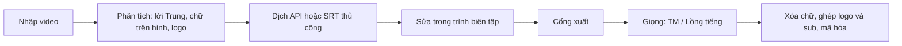

# DubFlow — Luồng logic kỹ thuật hiện tại

Cập nhật: 02/11/2026 (sau P1–P6), múi giờ Asia/Saigon.

Tài liệu mô tả phần đã có trong mã nguồn. Các kiểm tra cấu trúc, ASR, giải mã file không phải chứng nhận bản dịch, cảm xúc hay chất lượng video đã đạt. Thiết kế gốc: `docs/superpowers/specs/2026-11-01-dubflow-web-v2-design.md`; nghiệm thu từng phase: `docs/superpowers/reports/`. Đường dẫn dưới đây tương đối với `D:\DuAnKhoiNghiep\DubFlow`; `pipeline.py` = `backend/dubflow/pipeline.py`.

## 1. Tổng quan

Luồng: **nhập video → phân tích (lời gốc Trung, chữ trên hình, logo) → dịch (API hoặc thủ công) → xem/sửa trong trình biên tập → xuất**. Phân tích, dịch và xuất là ba tác vụ riêng của worker (`worker.py:run_task`, action `analyze` / `translate` / `detect_logos` / xuất). Phân tích không tự dịch và không tự xuất.

## 2. Kiến trúc, lưu trữ, venv

| Thành phần | Vai trò |
|---|---|
| React + TypeScript (Vite) | Giao diện; `frontend/src` |
| FastAPI (`app.py`) + SQLite (`store.py`) | API, dữ liệu job, bộ sưu tập, giọng, cài đặt |
| Worker cục bộ (`worker.py`) | Một tác vụ nặng một lúc; `worker_lock` giữ một worker |
| FFmpeg / FFprobe | Xử lý media (đường dẫn `config.py`) |
| `engine_cli.py` | Mỗi bước model nặng chạy trong tiến trình Python riêng, đọc `engine-request.json`, ghi log `<stage>.log` và `runtime-metrics.json` |

Mọi dữ liệu nằm ở `data/` trên ổ D: `data/jobs/<id>/` (nguồn, `cues.json`, `regions.json`, take, `clean.mp4`, `output.mp4`, log), `data/logos/` (thư viện logo), `data/voices/`. Bản `D:\OmniVoice` chỉ đọc.

Tiến trình con được chọn theo `pipeline.py:engine` (dòng 296):

| Stage (`engine_cli.STAGES`) | Python (config) | Model |
|---|---|---|
| `separate`, `transcribe`, `refs`, `pick`, `gen_omni` | `asr_python` = venv của `D:\OmniVoice` (chỉ đọc) | HTDemucs, Whisper large-v3-turbo, OmniVoice (fp16) |
| `gen` | `tts_python` = `repo-tests/clone-voxcpm` | VoxCPM2 |
| `ocr`, `subtrack`, `erase`, `logos` | `ocr_python` = `repo-tests/ocr` | RapidOCR (CPU), LaMa ONNX (`models/lama/lama_fp32.onnx`, CUDA DLL qua `cuda_dll_dir`) |
| `speakers`, `similarity` | `speaker_python` = `repo-tests/speaker-runtime` | ECAPA (`models/speaker-ecapa-voxceleb`, CPU) |

Dịch không đi qua tiến trình con: `translate_run.run_job` gọi HTTP trực tiếp trong worker. Mọi tiến trình con chạy với `HF_HUB_OFFLINE=1`, không tải model. `gen_omni` đặt TMP vào `<job>/tmp` để không ghi vào cây OmniVoice.

## 3. Ba chế độ và các bước theo chế độ

Chế độ do người dùng chọn lúc nhập (`default_mode` trong cài đặt, mặc định `dub`).

| Bước | Vietsub | Thuyết minh (`tm`) | Lồng tiếng (`dub`) |
|---|---|---|---|
| separate (Demucs) | không | không | có |
| transcribe + subtrack + dựng cue | có | có | có (trên `vocals.wav`) |
| ocr, logos, erase | có | có | có |
| speakers (ECAPA) | chạy (điều kiện chỉ loại `tm`) | không | có |
| refs (mẫu giọng theo người nói) | không | không | có |
| synthesize | không | một giọng thư viện | theo từng người nói |
| âm thanh xuất | giữ âm gốc | âm gốc hạ + giọng đọc | `background.wav` + giọng |

Sơ đồ gọi: `pipeline.py:prepare` (dòng 574) cho phân tích; `synthesize` (743); `render` (1017). Trong tác vụ xuất, `worker.py` chạy theo thứ tự: `review.require_export` → (`prepare` nếu thiếu `regions.json` hoặc thiếu stem dub) → `synthesize` (trừ vietsub) → `render` → `publisher.publish`.

Thuyết minh vẫn giữ lời ở dạng thoại và dùng một giọng; chưa có bước tự chuyển sang lời kể. Không có lip-sync ở cả ba chế độ.

## 4. Phân tích video (`pipeline.py:prepare`)

### 4.1. Lời gốc Trung (P1)

Nguồn câu Trung chuẩn cho mọi chế độ, mỗi cue có `id, start, end, original, source (ocr | asr | ocr+asr), flags, speaker`.

1. **Whisper** (`engine_cli.py:transcribe`) cho cue ASR (`source-asr-cues.json`). Chạy trên `vocals.wav` nếu có (dub), nếu không thì trên video.
2. **Sub ghi cứng** (`engine_cli.py:subtrack`): quét 2 fps để tìm dải chữ (`subtitle_track.auto_band`), 10 fps để cắt đoạn, RapidOCR bỏ phiếu chữ → `subtrack.json`.
3. **Dựng cue** (`pipeline.py:build_source` → `subtitle_track.build_source_cues`): sub trên hình là chuẩn cho chữ và thời gian; đoạn có lời nói mà không có sub thành cue `asr`; chữ OCR lệch Whisper quá ngưỡng thì gắn cờ `source_mismatch` (chỉ cảnh báo, không tự sửa). Cue `asr` được căn vào biên lời nói bằng RMS (`snap_to_speech`) và bị chặn trong khoảng OCR kề (`clamp_asr_to_ocr`).
4. Ghi `cues.json`, `source-build.json`. Không có sub lẫn lời: cảnh báo "thêm hoặc nhập cue thủ công".

Xuất lời Trung: `GET /api/jobs/{id}/source-subtitles.srt` (`app.py`) dùng `dialogue_export.dialogue_source_cues` lọc lời hát/ghi chú; chỉ ảnh hưởng file xuất.

### 4.2. Chữ trên hình (OCR)

`engine_cli.py:ocr` (RapidOCR CPU) ghi `regions.json` với các vùng `kind`: `subtitle` (sub nguồn), `transient` (chữ thoáng qua, cần dịch), `static` (logo/chữ cố định). `pipeline.refine_text_regions` nâng mặt nạ cũ mà không đè bản dịch hay lựa chọn của người dùng. Mảnh OCR tối đa 2 ký tự và dưới 0,5 s (`textcheck.screen_text_noise`) chỉ là gợi ý xem lại (`review.quality_report`, mã `SCREEN_TEXT_UNTRANSLATED`, `severity='review'`), không chặn xuất nháp.

### 4.3. Phát hiện logo (P4)

`pipeline.py:detect_logos` → `engine_cli.py:logos` + `logo_detect.py`: lấy mẫu khung thưa, tìm vùng đứng yên có nét cạnh (tần suất nét trung bình trong khoảng xuất hiện ≥ 0,68, tối thiểu 8 mẫu; clip dưới 48 s lấy dày, tối thiểu 24 mẫu), loại vùng trùng sub, gộp mảnh OCR `static` cũ. Kết quả `logo-candidates.json` (khóa `source_hash`, chỉ chạy lại khi video đổi hoặc `force`) và được gộp vào `regions.json` với cờ `auto`.

**Quy tắc xóa:** chỉ ứng viên tự dò đã được người dùng bấm ✓ (`confirmed`) hoặc vùng người dùng tự vẽ (không `auto`) mới bị xóa — `pipeline.py:erases_static`. Ứng viên chưa ✓ chỉ là "Gợi ý" trên UI: LaMa và ffmpeg không đụng tới, không tính vào `static_hash`, không bật cờ `erased`. Bấm ✓ làm job hết hạn (`done` → `awaiting_review`), lần xuất sau mới xóa.

API: `POST /api/jobs/{id}/detect-logos` (tác vụ `detect_logos`, job trở lại trạng thái cũ, lỗi chỉ thành cảnh báo); `PUT /api/jobs/{id}/regions` để ✓/✗/vẽ vùng (tọa độ pixel video gốc, UI trừ viền letterbox).

### 4.4. Xóa chữ nguồn và logo (LaMa)

`pipeline.py:erase_subtitles` → `engine_cli.py:erase` + `subtitle_erase.py`: xóa đúng nét chữ (mặt nạ glyph nở 2–3 px) của đoạn sub trong `subtrack.json` và các vùng static đã xác nhận, vẽ nền bằng LaMa (tái dùng kết quả khi cảnh tĩnh: `lama_reuse_tol`), ghi `clean.mp4` và `erase.json`. Chạy ở cuối `prepare` (sau logo) và lại ở `render` nếu `clean.mp4` hết hạn. Nếu LaMa lỗi, rơi về làm mờ ffmpeg và ghi `erase-failed.json` để không lặp lại cho cùng đầu vào; cảnh báo hiện cho người dùng.

### 4.5. Phân nhóm giọng

`speakers.py` (ECAPA) tạo ứng viên nhóm giọng từ cue dài ≥ 1,2 s; nhóm kém tin cậy giữ nhãn chưa rõ. Chỉ là ứng viên, không phải nhận diện nhân vật. Dub cần nhãn người nói để lấy mẫu giọng.

## 5. Dịch (P3)

Hai đường, cùng ghi vào trường `text` của cue và giữ nguyên `start/end`.

**API** (`translate_run.py:run_job`, `translate_job.py`, `translate_api.py`): provider Gemini / OpenAI / Anthropic qua HTTP (`make_provider`), cấu hình ở Cài đặt (`preferences.py`: provider, key, model, `translation_tier` free/paid, `rate_rpm=10`, `rate_rpd=250`, đơn giá, `cost_cap_usd`, `vietsub_cps=17`). Gemini được làm và test thật trước.
- `GET /translate/estimate` cho ước tính request/token/USD; `POST /translate` (`scope` = `missing` hoặc `all`, `allow_over_cap`) đưa tác vụ `translate` vào hàng đợi. Web không gọi API khi chưa có key và model (`translation_ready`).
- Một request gửi toàn bộ câu kèm id, trả JSON có cấu trúc (bảng nhân vật/xưng hô/thuật ngữ + bản dịch đúng chế độ). Video vượt ngân sách token chia phần theo khoảng lặng, mang theo bảng context. Câu lỗi (thiếu id, trống, cắt cụt, quá dài theo `max_chars`/`max_syllables`) gom gửi lại một lần.
- Cache `translation-cache-v2.json` theo (cue, chế độ, model, `PROMPT_VERSION`); xuất lại không gọi API. Giới hạn tốc độ `translation-rate.json`; 429 chờ `Retry-After` hoặc backoff; hết hạn mức ngày → tạm dừng, giữ phần đã dịch, "Dịch tiếp". Vượt trần chi phí → dừng và hỏi. Dùng thực tế ghi ở `translation-usage.json`, log ở `translation-runs/`. Key chuyển qua biến môi trường/đối tượng provider, được `scrub` khỏi thông báo.
- Đổi chế độ không tự dịch lại.

**Thủ công, không API:** `GET /translate-prompt?mode=` trả lệnh mẫu (`manual_translation.prompt_text`); xuất SRT Trung ở 4.1; `POST /translation-srt` nhập SRT Việt: ghép theo số thứ tự, kiểm tra đủ số câu/mã, **thời gian luôn lấy từ bản gốc** (bỏ timestamp trong file), báo lỗi 422 khi lệch.

Kiểm tra cấu trúc không chứng nhận nghĩa; xưng hô, thành ngữ vẫn có thể sai.

## 6. Trình biên tập và logo của người dùng (P4/P6)

Người dùng sửa trực tiếp ở "Lời dịch"; không bắt buộc màn hình duyệt riêng. Cổng xuất ở mục 8.1.

**Sub Việt** (`subtitle_style.py`, `pipeline.py:make_ass`): Roboto Bold đóng gói (`assets/fonts`, `fontsdir` cho libass), trắng viền đen, cao khoảng 5,5% khung, tối đa 2 dòng; hàm tính cỡ/vị trí dùng chung cho ASS và `SubtitlePreview.tsx`. Sub đặt tại hộp của sub Trung cũ.

**Logo/overlay của người dùng** (`logos.py`, `app.py`):
- Thư viện: `POST /api/logos` (ảnh PNG/JPEG/WebP ≤ 5 MB, ≤ 4096 px, mã hóa lại thành PNG RGBA; id = sha256, trùng thì dùng lại); `POST /api/logos/text` (logo chữ: font Roboto, màu, viền, cỡ, ≤ 60 ký tự; sửa = tạo logo mới); `GET /api/logos`, `GET /api/logos/{id}/image`, `DELETE` (409 khi đang dùng; xóa luôn `default_overlay` nếu trỏ vào đó). Lưu ở `data/logos/<id>.png`.
- Overlay theo job: `PUT /api/jobs/{id}/overlays` (tối đa 20; `x,y,width,height` theo pixel video gốc, `opacity`, `start/end`; hộp được thu và dời vào khung). Job `done` quay lại `awaiting_review`; `clean.mp4` giữ nguyên.
- Mặc định cho video mới: tùy chọn `default_overlay` (`logo_id, fx, fy, fw, opacity` theo tỉ lệ khung, cao suy từ tỉ lệ logo) trong cài đặt; `POST /api/jobs` gắn thành một overlay toàn thời lượng nếu logo còn.
- Khi xuất, logo được vẽ **trên cùng, đè lên sub** (`render` bước overlay sau `ass=`); phép co độ phân giải đầu ra đặt sau logo để tọa độ pixel gốc còn đúng. File logo mất → NeedsReview tiếng Việt.
- UI: popover "Chèn logo" (`LogoPicker.tsx`), kéo/đổi cỡ trên trình phát và thanh công cụ độ mờ/Từ/Đến/"đặt làm mặc định" (`LogoOverlay.tsx`). Khung ✓/✗/vẽ vùng che dùng chung trình phát.

## 7. Giọng (P5) — `pipeline.py:synthesize` (743)

### 7.1. Thứ tự engine

- **TM:** OmniVoice trước (`max_takes`, mặc định 24), rồi VoxCPM2 dự phòng (`fallback_takes`, mặc định 8) chỉ cho dòng OmniVoice chưa đạt.
- **Dub:** VoxCPM2 chế độ mix (mẫu giọng người nói + đoạn mồi tiếng Việt `vi-prompt.json`) trước, rồi OmniVoice dự phòng cho dòng chưa đạt.
- Engine thứ hai chỉ nhận các dòng engine đầu không qua được. Một engine lỗi/crash không dừng engine kia; lỗi ghi vào `errors`.
- Dub: mẫu giọng mỗi người nói do `engine_cli.py:refs` cắt từ `vocals.wav`; clip dưới 2 s hoặc RMS < 0,005 → bỏ OmniVoice cho dòng đó (`omni_reference_problem`). OmniVoice cần lời gốc của mẫu giọng.
- Chỉ một model GPU nặng một lúc: mỗi lần gọi `engine(...)` là tiến trình riêng, thoát là trả VRAM.

### 7.2. Vòng take (cho mỗi engine)

`take_rounds(budget)` = 4, 8, ..., budget (đợt 4 take, seed 1000+). Mỗi đợt: `gen`/`gen_omni` → `pick` → `settle`.
1. **Whisper khớp lời** (`engine_cli.py:pick`, `text_match`): cắt lặng đầu/cuối, nhận dạng tiếng Việt, so token sau khi chuẩn hóa dấu (kĩ/kỹ, hoà/hòa, i/y — `pipeline.tokens`) và áp bản đồ phát âm của giọng (`apply_pronounce`) ở cả hai phía. Khớp = trùng token đúng thứ tự (bỏ qua dấu câu, hoa thường).
2. **Luật câu ngắn:** dòng 2–3 từ chấp nhận lệch đúng một từ thay thế (cùng số từ, không rơi từ); dòng 1 từ chỉ chấp nhận khớp tuyệt đối. Take theo luật này (`short_rule`) chỉ vào pool khi không có take khớp tuyệt đối và phải có similarity ≥ 0,35 (hoặc chưa đo).
3. **Similarity ECAPA** (`similarity`, CPU): cosine giữa take đạt và mẫu giọng; lỗi bước này không chặn mà đổi sang chọn theo thời lượng kèm cảnh báo.
4. **Chọn take** (`choose_take`): trong pool khớp, lấy similarity cao nhất (chênh ≤ 0,02 coi là hòa), rồi take vừa slot (`≤ slot+0,3 s`, gần slot nhất), nếu không có thì take ngắn nhất.
5. **Đặt lên timeline** (`place`): giữ tốc độ tự nhiên, không time-stretch; câu dài đẩy trễ, trễ > 0,5 s hoặc tràn > 0,3 s hoặc vượt thời lượng video → `timing-review.json` + NeedsReview, không cắt lời. Trộn `adelay` + `amix` + `alimiter` → `dry.wav`, `manifest.json`.

### 7.3. voice-report.json và NeedsReview

`write_voice_report`: mỗi dòng có engine thắng, số take mỗi engine, `short_rule`, lý do bỏ engine (`skipped`), và `errors` theo engine. Dòng không engine nào đạt → `NeedsReview` (`failure_message`) nêu số dòng, engine đã thử, lỗi; job về `awaiting_review`, không có audio sai lọt ra. Sửa lời Việt dòng đó rồi tạo lại giọng (take đã đạt giữ nguyên nhờ cache).

### 7.4. Bộ nạp VoxCPM2 streaming và ghi chú bộ nhớ

`engine_cli.py:gen` (+ `LazyWeights`, `stream_load_state_dict`, `cpu_rope_tables`): trên Windows, đọc header safetensors, dựng model thẳng trên GPU và chép từng tensor (không mmap 4,6 GB); rotary tính lại trên CPU. Đỉnh commit lúc nạp khoảng 7,7 GiB (sinh giọng khoảng 8,8 GiB), nạp khoảng 5 s. Máy 16 GB đang mở nhiều app vẫn có thể thiếu commit (os error 1455) → engine báo lỗi, dub tự chuyển sang OmniVoice (chỉ qua được các dòng đạt) và ghi lỗi vào `voice-report.json`.

## 8. Xuất (`pipeline.py:render`, 1017)

### 8.1. Cổng xuất chạy trước mọi bước nặng

Thứ tự: `worker.py` gọi `review.require_export` (kind `draft`/`final`; lỗi dữ liệu, câu trống, vùng chữ error chặn) → synthesize → `render` kiểm lại cue, `require_export`, `manifest.json` (cue/giọng/reference không đổi, thời gian vẫn hợp lệ) **trước** OCR refine, logo, erase và encode. Job bị chặn báo lỗi trong vài giây thay vì sau vài phút. Chữ thoáng qua chưa dịch (trừ nhiễu OCR) → NeedsReview.

### 8.2. Dựng đồ thị ffmpeg

1. `refine_text_regions`, `ensure_logo_candidates` (job cũ), rồi `erase_subtitles(accept_fallback=True)` nếu `clean.mp4` hết hạn.
2. `captions.ass` (`make_ass`), rồi nguồn video = `clean.mp4` nếu còn hiệu lực, ngược lại video gốc + mặt nạ.
3. **Mặt nạ vùng chữ thoáng qua theo cửa sổ thời gian** (`subtitle_mask.windowed_filters`, `time_segments`): vùng cả clip xử lý một lần; các vùng khác xử lý theo từng đoạn (`trim` + `setpts` + `concat`), mỗi đoạn chỉ mang vùng đang hoạt động, không dùng `enable=`. Atlas glyph đọc bằng `movie=` trong đồ thị (không dùng thêm `-i`, vì nhiều input làm ffmpeg kẹt/hết bộ nhớ). Nhờ vậy TM 106 s: 1431 s → 56 s.
4. `ass=` (Roboto qua `fontsdir`), overlay logo (6), scale, rồi âm thanh: vietsub `0:a:0?`; TM âm gốc ×0,32 + giọng ×0,9; dub `background.wav` + giọng; `loudnorm`. Lưu ý `original_gain` (cài đặt, mặc định 0,32) luôn ghi đè hệ số nền mặc định của dub (0,8) vì `effective_settings` luôn đặt giá trị này.
5. Đồ thị ghi `render-filter.txt` (`-filter_complex_script`) để tránh giới hạn dòng lệnh Windows.

### 8.3. Mã hóa

`video_encoder` (`Settings.video_encoder` / `DUBFLOW_VIDEO_ENCODER`: `auto|nvenc|libx264`): `auto` thăm dò `h264_nvenc` một lần mỗi ffmpeg (`nvenc_available`). NVENC dùng `NVENC_ARGS` (p5, vbr, cq 26, spatial AQ). Nếu NVENC lỗi lúc chạy hoặc output thiếu khung (`frames_missing`) thì dựng lại bằng libx264 crf 20 (hủy không thử lại). Sau mã hóa luôn giải mã kiểm tra `-xerror`. Giải mã được chỉ chứng nhận file đọc được. Sau đó cắt `parts.json` (không cắt giữa từ nói), `publisher.publish` đưa file vào thư mục xuất.

### 8.4. Bỏ qua mã hóa khi không đổi

`render_key` (`pipeline.py:1000`) = hash toàn bộ lệnh ffmpeg, đồ thị, `captions.ass`, nội dung mọi file đầu vào (file > 32 MB theo size+mtime), mặt nạ, logo, encoder, kích thước/fps. Khớp `render-key.json` và output còn đủ khung → bỏ encode ("reusing output.mp4"). Khóa chỉ được ghi sau khi kiểm tra giải mã xong, và bị xóa trước mỗi lần encode.

## 9. Cache và điều kiện chạy lại theo bước

| Bước | Bỏ qua khi | Khóa / dấu | Chạy lại khi |
|---|---|---|---|
| separate | có `background.wav` + `vocals.wav` và dấu khớp | `separate.json` = hash nguồn (`source_stamp`) | thay `source.mp4`; job cũ không có dấu tự nhận dấu |
| transcribe + dựng cue | `cues.json` không rỗng và dấu khớp | `transcribe.json` = hash audio + thời lượng | xóa cue (Phân tích lại lời gốc), đổi nguồn |
| ocr | `regions.json` tồn tại (hoặc `ocr-complete.json`, `mask_version>=2`) | tệp tồn tại | xóa `regions.json` |
| logos | `source_hash` trong `logo-candidates.json` = hash video | `file_hash(source)` | video đổi, OCR ghi lại regions, hoặc `detect-logos` (force) |
| erase | `erase.json` còn hiệu lực | `ERASE_VERSION`, size+mtime nguồn, `subtrack_hash`, `static_hash` (chỉ vùng đã ✓/tự vẽ), fps, ngưỡng, trạng thái fallback LaMa; `erase-failed.json` nhớ lần hỏng | sub/vùng static đổi, bấm ✓/✗, LaMa khả dụng sau khi từng rơi fallback |
| speakers | `speaker-candidates.json` khớp | chữ ký (id/start/end/original) các cue | cue đổi |
| refs (dub) | `reference-inputs.json` khớp, đủ người nói | cue + hash `vocals.wav` + version | cue/nhãn người nói đổi |
| gen / gen_omni | file take đã có | tên file = `cache_key(tham số + seed)`; tham số gồm hash reference, lời, model/revision, `take_code_hash()` (chỉ mã gen/gen_omni/pick/similarity/text_match/bộ nạp và `tokens`) | đổi lời Việt, reference, model, mã giọng; sửa OCR/erase/logo không làm mất take |
| pick / similarity | take đã có trong `state.json` (đã chấm / đã có similarity) | `state.json[key]` | take mới |
| nạp model | `gen`, `gen_omni`, `pick` trả về sớm nếu mọi take đã có/đã chấm (`takes_missing`) | — | còn thiếu take |
| dịch | cache từng câu | `translation-cache-v2.json` (cue, chế độ, model, `PROMPT_VERSION`) | `scope=all` hoặc nội dung đổi |
| render | `render-key.json` khớp và output đủ khung | xem 8.4 | bất kỳ đầu vào nào đổi |

Chỉnh sửa của người dùng làm job `done` → `awaiting_review` (`invalidate`), không xóa `clean.mp4` trừ khi đầu vào erase đổi.

## 10. Giới hạn đã biết

- **Tốc độ erase:** chưa tối ưu. dub2 60 s với 1 logo tĩnh khoảng 182 s (LaMa 357 lần gọi model); trước khi siết bộ dò logo, 24 ứng viên nhầm làm erase 2857 s. Ngưỡng 0,68 chỉ kiểm chứng trên 3 video; logo trên nền sáng có thể bị tính kết thúc sớm. Người dùng phải ✓ thì logo mới bị xóa.
- **Nạp model theo đợt:** mỗi đợt 4 take nạp lại model (khoảng 12–16 s gen, 10–13 s Whisper). Dòng khó đi qua tới 6 đợt mỗi engine (24 take) nên tốn 140–170 s nạp mỗi engine; chưa có tiến trình model chạy lâu. `takes_missing` chỉ tránh nạp khi không còn gì để ghi.
- **Thời gian giọng:** TM 106 s synth 1547 s lần đầu (OmniVoice 24 take cho câu khó); dub 60 s, 88 take khoảng 1432 s (16 s/take gồm Whisper + ECAPA). Render sau tối ưu: TM 56–62 s, dub 17–34 s khi `clean.mp4` còn hiệu lực.
- **Video chỉ có lời nói:** khối ASR có thể trộn lời hai người (ví dụ video 76b9), nên không lồng tiếng theo từng người được; timestamp Whisper không phải căn từng từ.
- **Người nói < 1,2 s:** `speakers` bỏ qua cue ngắn hơn 1,2 s; video toàn câu ngắn cần người dùng gán nhãn tay.
- **VoxCPM2 trên 16 GB:** thiếu commit khi mở nhiều app vẫn có thể lỗi (mục 7.4).
- **NVENC:** một lần quan sát bỏ khung (2135/3181) chưa tái hiện; đã có chốt đếm khung và rơi về libx264. File NVENC (cq 26) lớn hơn libx264 crf 20.
- **Đồ thị cắt thời gian:** có khoảng 2 filter mỗi đoạn mỗi khung; clip rất dài với hàng trăm vùng vẫn chậm theo số đoạn.
- Chưa bảo đảm: đúng nghĩa/xưng hô, giống giọng và cảm xúc khi đổi ngôn ngữ, che sạch mọi dấu vết chữ trên nền phức tạp, nhận diện chắc chắn người nói/nhân vật/người nghe, lọc hết lời hát. Chưa có lip-sync, chưa tự học từ chỉnh sửa. Bản xem trước (CSS) và bản xuất (ffmpeg) là hai cơ chế khác nhau: cần kiểm file xuất thật.

## 11. Mã nguồn liên quan

| File | Vai trò |
|---|---|
| `backend/dubflow/app.py` | API job, cues, regions, logos/overlays, detect-logos, translate, render, voices, media |
| `backend/dubflow/worker.py` | Hàng đợi; `run_task` cho analyze / translate / detect_logos / xuất |
| `backend/dubflow/pipeline.py` | `prepare`, `build_source`, `detect_logos`, `erase_subtitles`, `synthesize`, `render`, khóa cache |
| `backend/dubflow/engine_cli.py` | Stage model nặng (`STAGES`), bộ nạp VoxCPM2, `pick`/`similarity`/`text_match` |
| `backend/dubflow/subtitle_track.py`, `subtitle_cues.py` | Sub ghi cứng, dựng cue ASR/OCR |
| `backend/dubflow/logo_detect.py`, `logos.py` | Dò logo; thư viện logo và overlay |
| `backend/dubflow/subtitle_erase.py`, `subtitle_mask.py`, `subtitle_style.py` | Xóa chữ (LaMa), mặt nạ/đồ thị theo cửa sổ, kiểu sub |
| `backend/dubflow/translate_run.py`, `translate_job.py`, `translate_api.py`, `manual_translation.py` | Dịch API, cache/giới hạn/chi phí, SRT thủ công |
| `backend/dubflow/review.py`, `textcheck.py` | Báo cáo chất lượng, cổng xuất, nhiễu OCR |
| `backend/dubflow/speakers.py`, `voices.py` | Nhóm giọng ECAPA; thư viện giọng |
| `backend/dubflow/preferences.py`, `config.py` | Cài đặt bền vững, đường dẫn venv/model |
| `backend/dubflow/dialogue_export.py`, `publisher.py` | Lọc SRT Trung; xuất ra thư mục cấu hình |
| `frontend/src/Player.tsx`, `SubtitlePreview.tsx`, `LogoOverlay.tsx`, `LogoPicker.tsx` | Trình phát, xem trước sub, logo/overlay |
